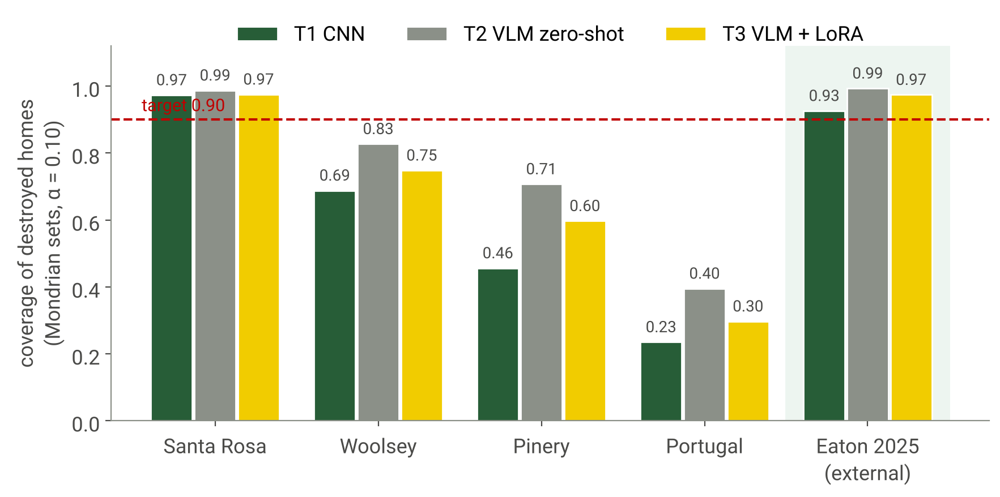

# WildfireDamageCP

Building damage assessment from satellite images after wildfires, with calibrated uncertainty.
Instead of a single label per building, each model returns a small set of possible damage levels
(conformal prediction). Buildings with a single-label set are labelled automatically; the rest are
sent to a field inspector. The question is how much inspection work this saves, and whether the
error guarantees still hold on a fire the model has never seen.


## What it does

1. Crops a 64 m × 64 m pre-fire and post-fire image around every building (224 × 224 px).
2. Predicts *no damage / damaged / destroyed* with one of three models:
   - **T1**: Siamese ConvNeXt-Tiny trained on the crops
   - **T2**: Qwen3-VL-8B-Instruct, zero-shot, probabilities from the A/B/C answer tokens
   - **T3**: the same VLM fine-tuned with LoRA
3. Calibrates the probabilities with temperature scaling.
4. Builds split-conformal prediction sets at 90% target coverage (LAC, APS, ordinal, class-conditional).
5. Routes buildings: single-label sets are auto-labelled, larger sets go to an inspector. The threshold
   is chosen on calibration fires so that at most 5% of destroyed buildings are auto-labelled as something else.

Evaluation is leave-one-fire-out over four xBD wildfires, plus an external test on the 2025 Eaton Fire
(Los Angeles) using CAL FIRE field-inspection labels and Maxar WorldView-3 imagery.

## Results

| | T1 CNN | T2 VLM zero-shot | T3 VLM + LoRA |
|---|---|---|---|
| Macro-F1, held-out xBD fires | 0.53–0.67 | 0.31–0.40 | 0.52–0.67 |
| Macro-F1, Eaton 2025 | 0.68 | 0.43 | 0.69 |
| ECE after temperature scaling | 0.010–0.036 | 0.07–0.23 | 0.012–0.031 |
| Eaton: auto-labelled / destroyed missed (APS) | 91% / 2.8% | – | 93% / 1.0% |

- On Eaton the routing works: about 93% of buildings need no visit and about 1% of destroyed homes are missed.
- On xBD fires that look different from the training fires (Woolsey, Pinery, Portugal), the guarantees
  do not transfer. Coverage of destroyed buildings drops to 0.24–0.40 on Portugal, and 9–43% of destroyed
  buildings are missed by the routing rule.
- Recalibrating on 100–300 labelled buildings from the new fire restores coverage, but not the 5% miss target.
- The *damaged* class is barely learned by any model (F1 ≤ 0.22); it is rare and often not visible from above.

Full tables are in [`results/tables/report_tables.md`](results/tables/report_tables.md) and a short write-up
in [`docs/results_summary.md`](docs/results_summary.md).



## Data

Not included in this repository.

| Dataset | Use | Source |
|---|---|---|
| xBD / xView2 (full GeoTIFF release) | training and leave-one-fire-out testing | [xview2.org](https://xview2.org) |
| CAL FIRE DINS 2025 Eaton | external test labels | [Data.gov](https://catalog.data.gov/dataset/dins-2025-eaton-public-view) |
| Maxar Open Data, WildFires-LosAngeles-Jan-2025 | external test imagery | [AWS Open Data](https://registry.opendata.aws/maxar-open-data/) |

Labels are mapped to three classes: no damage; damaged (xBD minor + major, DINS 1–50%); destroyed.
xBD's `socal-fire` and `woolsey-fire` cover the same area and are treated as one fire.

| Fire | No damage | Damaged | Destroyed | Total |
|---|---|---|---|---|
| Santa Rosa 2017 | 15,843 | 216 | 5,810 | 21,869 |
| Woolsey 2018 | 20,238 | 558 | 4,180 | 24,976 |
| Pinery 2015 | 5,019 | 180 | 229 | 5,428 |
| Portugal 2017 | 20,787 | 472 | 1,090 | 22,349 |
| Eaton 2025 | 4,007 | 543 | 3,907 | 8,457 |

## Repository layout

```
configs/          analysis rules (preregistration.md), VLM prompt, split checksums, package versions
scripts/
  data_prep/      label counts, Maxar download, crop extraction, Eaton alignment check
  checks/         sanity checks on splits and outputs
  report/         figure and report builders
src/
  make_splits.py  leave-one-fire-out splits by ~500 m grid cell
  t1_train.py     T1 CNN
  t2_full.py      T2 zero-shot VLM
  t3_train.py     T3 LoRA fine-tuning
  phase5.py       temperature scaling, conformal sets, routing, bootstrap CIs
  phase7_*.py     tables and figures
  e1_*.py         recalibration on a sample from the target fire
results/
  preds/          per-building predictions, one CSV per model × fold × seed
  tables/         all metrics
outputs/figures/  figures
```

Each prediction CSV has `id, source, role, label, logit_no, logit_dmg, logit_des, p_no, p_dmg, p_des`,
where `role` is `train/val/calib/test/eaton`. Every analysis from calibration onward runs from these files alone.

## Running it

Python 3.11, PyTorch 2.14, transformers 5.22, timm, peft (exact versions in `configs/env_versions.txt`).
Paths default to the repository root; set `WDCP_ROOT` to point elsewhere.

```bash
# data preparation (once)
python scripts/data_prep/download_maxar_eaton.py
python scripts/data_prep/extract_crops.py xbd .
python scripts/data_prep/extract_crops.py eaton .
python src/make_splits.py

# models (GPU; T1 and T3 were run for folds 1-4 and seeds 0-2)
python src/t1_train.py --fold 1 --seed 0
python src/t2_full.py 0 8          # chunk 0 of 8, then src/t2_merge.py
python src/t3_train.py --fold 1 --seed 0

# calibration, conformal sets, routing, tables, figures (CPU)
python src/phase5.py
python src/phase7_tables.py
python src/phase7_figs.py
python src/e1_recalibration.py && python src/e1_recalibration.py summarise
```

To reproduce only the analysis, the files in `results/preds/` are enough: start at `phase5.py`.

## Notes

- Models, metrics, α = 0.10 and the routing rule were fixed in `configs/preregistration.md` before training.
  Three later changes are recorded there and labelled in the tables: a revised α-selection rule (A1),
  randomised APS (P1, post-hoc) and the recalibration analysis (E1).
- xBD (CC BY-NC-SA) and Maxar Open Data (CC BY-NC 4.0) are for non-commercial use only.
