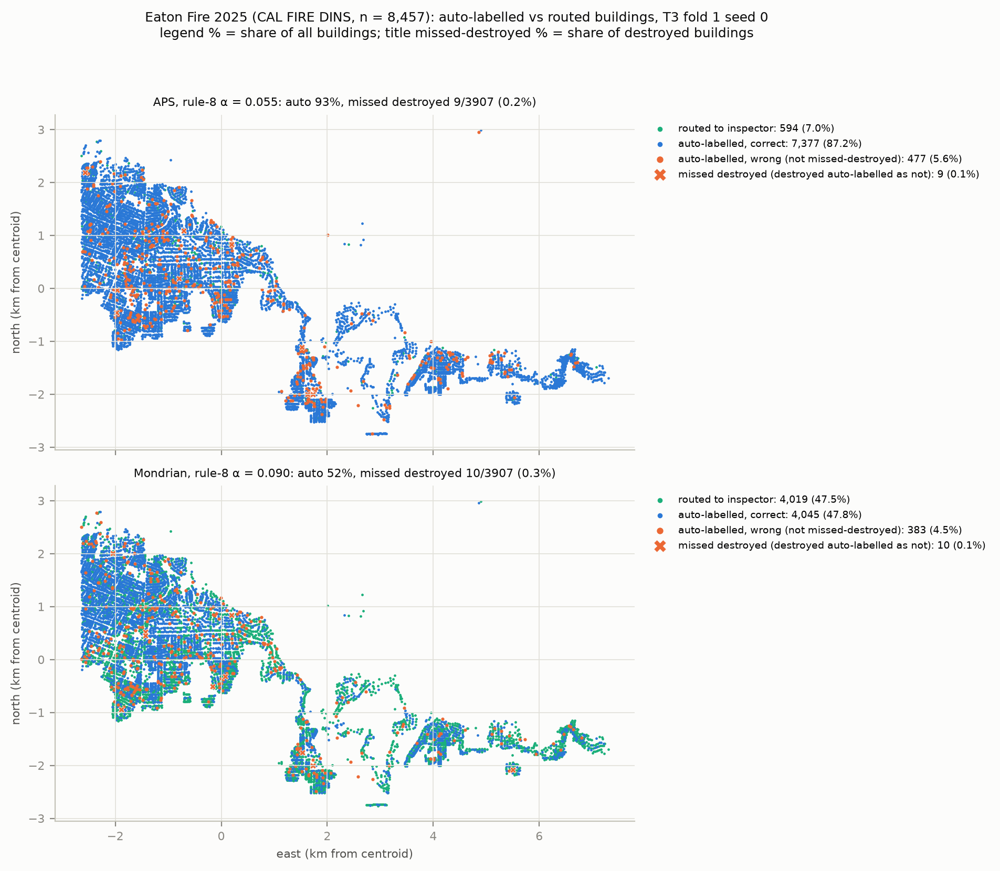
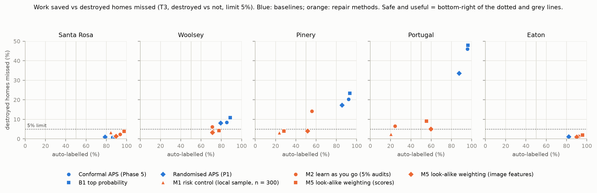

# WildfireDamageCP

**Knowing when to ask an inspector: calibrated building-damage assessment after wildfires.**

After a wildfire, every damaged home has to be inspected, which takes thousands of inspector-days. This project
asks how much of that work satellite AI can safely take over. Each model gives every building a calibrated set of
plausible damage levels (conformal prediction). Buildings with a single-label set are labelled automatically; the
rest go to a field inspector. The key question is whether the error guarantee, *at most 5% of destroyed homes
labelled as something else*, still holds on a fire the model has never seen.



## Highlights

- **Three model families** on 83,000 buildings: a Siamese ConvNeXt CNN, a vision-language model (Qwen3-VL-8B) used
  zero-shot, and the same VLM fine-tuned with LoRA; plus a second VLM (Gemma 4 12B) as a robustness check.
- **Calibration and conformal prediction:** temperature scaling; split-conformal sets (LAC, APS, ordinal,
  class-conditional); a routing rule tuned so that ≤ 5% of destroyed homes are missed on calibration fires.
- **Strict evaluation:** leave-one-fire-out over four xBD wildfires (spatial ~500 m grid-cell splits, no
  neighbourhood leakage), an external test on the **2025 Eaton Fire** against CAL FIRE field-inspection records,
  cluster-bootstrap confidence intervals, and analysis rules written down before the results were seen.
- **Stress tests of the routing idea:** simple confidence baselines, five methods for keeping the 5% limit on a
  new fire (risk control, adaptive thresholds with audits, label-shift and covariate-shift weighting, a
  shift alarm), a paired CNN-vs-VLM comparison and an inspector-workload model.

## Results

| | CNN (T1) | VLM zero-shot (T2) | VLM + LoRA (T3) |
|---|---|---|---|
| Macro-F1, held-out xBD fires | 0.53–0.67 | 0.31–0.40 | 0.52–0.67 |
| Macro-F1, Eaton 2025 | 0.68 | 0.43 | 0.69 |
| Destroyed-vs-not AUROC, held-out fires | 0.94–0.99 | 0.80–0.96 | 0.93–0.995 |
| Calibration error (ECE) after temperature scaling | 0.010–0.036 | 0.07–0.23 | 0.012–0.031 |
| Eaton: buildings auto-labelled / destroyed homes missed | 91% / 2.8% | – | 93% / 1.0% |

**What works.** On the 2025 Eaton Fire, about 93% of buildings need no visit while about 1% of destroyed homes are
missed. Fine-tuning makes the VLM as accurate as the task-specific CNN (equivalent within ±0.02 macro-F1 on three
of five targets, paired bootstrap) and better calibrated, and under routing it misses fewer destroyed homes on four of five targets.

**What breaks.** On fires that differ from the training fires (Woolsey, Pinery, Portugal), the guarantees do not
transfer: 9–43% of destroyed homes are missed, although the CNN and the fine-tuned VLM still *rank* destroyed homes well (AUROC ≥ 0.93).
The failure is where the cut-off lands, not the model's ranking.

**What the stress tests show** (T3, destroyed vs not):

| Approach | Keeps ≤ 5% missed on | Trade-off |
|---|---|---|
| Conformal routing (APS) | 2 of 5 targets | auto-labels 85–96% everywhere, even where it should be careful |
| Simple "accept if confident" rule | 2 of 5 | within about 3 points of conformal routing |
| Local risk control on 300 inspected houses | 5 of 5 | auto-labels only 20–24% on the hardest fires |
| Adaptive threshold with 5% random audits | 2 of 5 | missed destroyed on Portugal: 46% → 6.5% |
| Look-alike weighting on image features | 4 of 5 on average | single models fail on the two hardest fires |

- Conformal routing is no better than a simple confidence rule at saving work; its value is a guarantee that can be
  checked on similar fires, and a clear signal of when it is broken.
- Measuring how "different" a new fire looks from the model's predictions does **not** predict failure; a shift
  alarm built on it fires on every fire.
- A stronger zero-shot VLM (Gemma 4 12B) closes much of the gap to the fine-tuned model (macro-F1 0.46–0.64), so
  fine-tuning matters less than the Qwen zero-shot results suggest. Training T3 twice as long changes test macro-F1 by at most 0.003.
- The *damaged* class is barely learned by any model (F1 ≤ 0.22): it is rare and often invisible from above.



Full results: [`results/tables/report_tables.md`](results/tables/report_tables.md) (main analysis) and
[`results/tables/e2_report_tables.md`](results/tables/e2_report_tables.md) (stress tests), with reproducibility and
data-quality checks in [`results/tables/e2_checks.md`](results/tables/e2_checks.md). The numbers behind each stress-test
figure are in [`results/tables/e2_figure_data/`](results/tables/e2_figure_data/), ready to re-plot.
The full written report (Word) is [`docs/WildfireDamageCP_Report.docx`](docs/WildfireDamageCP_Report.docx).

## Data

Not included in this repository.

| Dataset | Use | Source |
|---|---|---|
| xBD / xView2 (full GeoTIFF release) | training and leave-one-fire-out testing | [xview2.org](https://xview2.org) |
| CAL FIRE DINS 2025 Eaton | external test labels | [Data.gov](https://catalog.data.gov/dataset/dins-2025-eaton-public-view) |
| Maxar Open Data, WildFires-LosAngeles-Jan-2025 | external test imagery | [AWS Open Data](https://registry.opendata.aws/maxar-open-data/) |

Labels are mapped to three classes: no damage; damaged (xBD minor + major, DINS 1–50%); destroyed.

| Fire | No damage | Damaged | Destroyed | Total |
|---|---|---|---|---|
| Santa Rosa 2017 | 15,843 | 216 | 5,810 | 21,869 |
| Woolsey 2018 | 20,238 | 558 | 4,180 | 24,976 |
| Pinery 2015 | 5,019 | 180 | 229 | 5,428 |
| Portugal 2017 | 20,787 | 472 | 1,090 | 22,349 |
| Eaton 2025 | 4,007 | 543 | 3,907 | 8,457 |

A second external test on the 2025 Palisades Fire was prepared but not run: the only pre-fire WorldView-3 image in
Maxar Open Data covers 15% of its buildings, and the pre/post alignment check failed its preset threshold.

## Repository layout

```
configs/            analysis rules (preregistration.md), VLM prompts, split checksums, package versions
scripts/data_prep/  label counts, Maxar download, crop extraction, alignment checks
scripts/checks/     consistency checks (including exact reproduction of the main results)
src/
  t1_train.py       Siamese ConvNeXt-Tiny
  t2_full.py        zero-shot VLM scoring (answer-token probabilities)
  t3_train.py       LoRA fine-tuning of Qwen3-VL-8B
  phase5.py         temperature scaling, conformal sets, routing, bootstrap CIs
  phase7_*.py       main tables and figures
  e1_*.py           recalibration on a sample from the new fire
  e2_*.py           stress tests: baselines, shift-robust routing, shift measures, paired tests, workload, VLM checks
results/preds/      per-building predictions, one CSV per model × fold × seed
results/tables/     all metrics
outputs/figures/    figures
```

Each prediction CSV has `id, source, role, label, logit_no, logit_dmg, logit_des, p_no, p_dmg, p_des`; every
analysis from calibration onward runs from these files alone, on a normal computer.

## Running it

Python 3.11, PyTorch 2.14, transformers 5.22, timm, peft (exact versions in `configs/env_versions.txt`).

```bash
# analysis only (CPU, minutes): starts from results/preds/
python src/phase5.py && python src/phase7_tables.py && python src/phase7_figs.py
python scripts/checks/test_e2.py          # reproduces the published routing numbers exactly
python src/e2_baselines.py && python src/e2_wp2.py && python src/e2_report.py

# full pipeline (data and GPU)
python scripts/data_prep/extract_crops.py xbd . && python scripts/data_prep/extract_crops.py eaton .
python src/make_splits.py
python src/t1_train.py --fold 1 --seed 0      # folds 1-4, seeds 0-2
python src/t3_train.py --fold 1 --seed 0
```

## Notes

- Models, metrics, the 90% coverage target and the routing rule were fixed in `configs/preregistration.md` before
  training. Analyses added later are labelled there and in every table (A1, P1, E1, E2).
- xBD (CC BY-NC-SA) and Maxar Open Data (CC BY-NC 4.0) are for non-commercial use.
